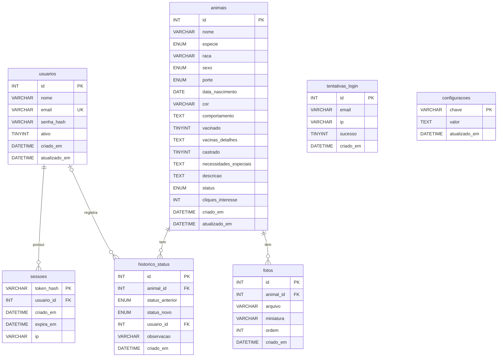

# AmparaPet — Documentação do Banco de Dados

| | |
|---|---|
| **SGBD** | MySQL 8.4 LTS (InnoDB) |
| **Banco** | `amparapet` (testes automatizados usam `amparapet_teste`) |
| **Codificação** | `utf8mb4` / `utf8mb4_0900_ai_ci` (aceita acentos e emojis; buscas ignoram maiúsculas e acentos) |
| **Script de criação** | [`schema.sql`](schema.sql) |
| **Tabelas** | 7 |
| **Versão do documento** | 1.0 — outubro de 2026 |

---

## 1. Visão geral

O banco guarda os animais do Abrigo Toca de Assis com suas fotos e o histórico de mudanças de status. Também guarda os administradores do sistema, as sessões de login, o registro de tentativas de login e os dados do abrigo que aparecem no site.

As tabelas se dividem em três grupos:

| Grupo | Tabelas | Requisitos atendidos |
|-------|---------|----------------------|
| **Animais** | `animais`, `fotos`, `historico_status` | RF01–RF06, RF08–RF10, RF14 |
| **Acesso administrativo** | `usuarios`, `sessoes`, `tentativas_login` | RF07, RNF05 |
| **Dados do abrigo** | `configuracoes` | RF06, RF11–RF13 |

### Modelo conceitual (MER)

Em linguagem natural, as entidades e relacionamentos são:

- Um **animal** **tem** zero ou muitas **fotos**. Cada foto pertence a exatamente um animal.
- Um **animal** **tem** zero ou muitos registros no **histórico de status**. Cada registro pertence a exatamente um animal.
- Um **usuário** (administrador) **registra** zero ou muitas mudanças no histórico. Cada mudança foi feita por zero ou um usuário. Pode ser zero porque o usuário pode ter sido excluído depois.
- Um **usuário** **possui** zero ou muitas **sessões** de login. Cada sessão pertence a exatamente um usuário.
- **Tentativas de login** e **configurações** são entidades independentes, sem relacionamentos.

---

## 2. Diagrama Entidade-Relacionamento (DER)

O arquivo vetorial está em [`der.svg`](der.svg) e pode ser ampliado sem perder qualidade.

Versão em Mermaid (o GitHub desenha automaticamente):

### Relacionamentos

| Relacionamento | Cardinalidade | Chave estrangeira | Ao excluir o "pai" |
|----------------|---------------|-------------------|--------------------|
| `animais` → `fotos` | 1 : 0..N | `fotos.animal_id` → `animais.id` | **CASCADE**: as fotos são apagadas junto |
| `animais` → `historico_status` | 1 : 0..N | `historico_status.animal_id` → `animais.id` | **CASCADE**: o histórico é apagado junto |
| `usuarios` → `historico_status` | 0..1 : 0..N | `historico_status.usuario_id` → `usuarios.id` | **SET NULL**: o histórico continua, sem o autor |
| `usuarios` → `sessoes` | 1 : 0..N | `sessoes.usuario_id` → `usuarios.id` | **CASCADE**: as sessões são encerradas |

---

## 3. Dicionário de dados

Legenda: **PK** chave primária · **FK** chave estrangeira · **UK** valor único · **Nulo** "Sim" quando o campo pode ficar vazio (NULL).
Os campos `criado_em` e `atualizado_em` são preenchidos pelo próprio MySQL. `atualizado_em` muda sozinho a cada alteração do registro.

### 3.1 `animais`

Animais cadastrados pelo abrigo, inclusive os já adotados (RF01, RF10).

| Coluna | Tipo | Chave | Nulo | Padrão | Descrição |
|--------|------|-------|------|--------|-----------|
| `id` | INT AUTO_INCREMENT | PK | Não | — | Código do animal (aparece na mensagem do WhatsApp, ex.: "#12") |
| `nome` | VARCHAR(80) | | Não | — | Nome do animal |
| `especie` | ENUM | | Não | — | `CAO` ou `GATO` |
| `raca` | VARCHAR(80) | | Não | `SRD` | Raça; SRD = sem raça definida |
| `sexo` | ENUM | | Não | — | `MACHO` ou `FEMEA` |
| `porte` | ENUM | | Não | — | `PEQUENO`, `MEDIO` ou `GRANDE` |
| `data_nascimento` | DATE | | Sim | NULL | Data **aproximada**. Se só souber mês/ano, usa-se o dia 01. A idade exibida é calculada a partir dela. |
| `cor` | VARCHAR(60) | | Sim | NULL | Cor da pelagem |
| `comportamento` | TEXT | | Sim | NULL | Temperamento (ex.: "dócil, se dá bem com gatos") |
| `vacinado` | TINYINT(1) | | Não | 0 | 1 = vacinado, 0 = não vacinado |
| `vacinas_detalhes` | TEXT | | Sim | NULL | Quais vacinas tomou (ex.: "V10 e antirrábica") |
| `castrado` | TINYINT(1) | | Não | 0 | 1 = castrado, 0 = não castrado |
| `necessidades_especiais` | TEXT | | Sim | NULL | Ex.: "cego de um olho", "toma medicação contínua" |
| `descricao` | TEXT | | Sim | NULL | Texto livre de apresentação |
| `status` | ENUM | | Não | `DISPONIVEL` | `DISPONIVEL`, `EM_PROCESSO` ou `ADOTADO` (RF08) |
| `cliques_interesse` | INT | | Não | 0 | Quantas vezes clicaram em "Tenho interesse" (RF06/RF14) |
| `criado_em` | DATETIME | | Não | agora | Data do cadastro |
| `atualizado_em` | DATETIME | | Não | agora | Data da última alteração |

Índices: `status`, `especie`, `porte`, `vacinado` e `castrado`, os campos usados nos filtros da vitrine (RF05).

### 3.2 `fotos`

Fotos dos animais (RF04). O banco guarda só o caminho; os arquivos ficam na pasta `uploads/animais/<id do animal>/`.

| Coluna | Tipo | Chave | Nulo | Padrão | Descrição |
|--------|------|-------|------|--------|-----------|
| `id` | INT AUTO_INCREMENT | PK | Não | — | Código da foto |
| `animal_id` | INT | FK → `animais.id` | Não | — | Animal a que a foto pertence |
| `arquivo` | VARCHAR(255) | | Não | — | Caminho da foto grande (WEBP, até 1600 px) dentro de `uploads/` |
| `miniatura` | VARCHAR(255) | | Não | — | Caminho da miniatura (WEBP, até 400 px), usada na vitrine |
| `ordem` | INT | | Não | 0 | Posição da foto; a de **menor** ordem é a foto principal |
| `criado_em` | DATETIME | | Não | agora | Data do envio |

Índice: `animal_id`.

### 3.3 `historico_status`

Todas as mudanças de status de cada animal (RF08, RF10). Nunca é editado, só recebe novos registros.

| Coluna | Tipo | Chave | Nulo | Padrão | Descrição |
|--------|------|-------|------|--------|-----------|
| `id` | INT AUTO_INCREMENT | PK | Não | — | Código do registro |
| `animal_id` | INT | FK → `animais.id` | Não | — | Animal que mudou de status |
| `status_anterior` | ENUM | | Sim | NULL | Status antes da mudança. NULL no registro do cadastro. |
| `status_novo` | ENUM | | Não | — | Status depois da mudança |
| `usuario_id` | INT | FK → `usuarios.id` | Sim | NULL | Administrador que fez a mudança (NULL se ele foi excluído) |
| `observacao` | VARCHAR(255) | | Sim | NULL | Ex.: "Adotado pela família Silva" |
| `criado_em` | DATETIME | | Não | agora | Data e hora da mudança |

Índices: `animal_id` e `usuario_id`.

### 3.4 `usuarios`

Administradores do sistema. Todos têm o mesmo nível de acesso.

| Coluna | Tipo | Chave | Nulo | Padrão | Descrição |
|--------|------|-------|------|--------|-----------|
| `id` | INT AUTO_INCREMENT | PK | Não | — | Código do usuário |
| `nome` | VARCHAR(100) | | Não | — | Nome completo |
| `email` | VARCHAR(150) | UK | Não | — | E-mail de login, sempre em minúsculas |
| `senha_hash` | VARCHAR(100) | | Não | — | Senha criptografada com **bcrypt**. A senha original nunca é gravada. |
| `ativo` | TINYINT(1) | | Não | 1 | 0 = desativado: não consegue mais entrar |
| `criado_em` | DATETIME | | Não | agora | Data do cadastro |
| `atualizado_em` | DATETIME | | Não | agora | Data da última alteração |

### 3.5 `sessoes`

Logins ativos (RF07). Quando alguém faz login, recebe um token aleatório. O banco guarda só o **hash SHA-256** desse token, então quem tiver acesso ao banco não consegue se passar por um usuário logado.

| Coluna | Tipo | Chave | Nulo | Padrão | Descrição |
|--------|------|-------|------|--------|-----------|
| `token_hash` | VARCHAR(64) | PK | Não | — | Hash SHA-256 do token da sessão |
| `usuario_id` | INT | FK → `usuarios.id` | Não | — | Dono da sessão |
| `criado_em` | DATETIME | | Não | agora | Hora do login |
| `expira_em` | DATETIME | | Não | — | Hora em que a sessão vence (padrão: 8 horas depois do login) |
| `ip` | VARCHAR(45) | | Sim | NULL | IP de onde o login foi feito (cabe IPv6) |

Índices: `usuario_id` e `expira_em`. As sessões vencidas são apagadas a cada novo login.

### 3.6 `tentativas_login`

Registro de cada tentativa de login, certa ou errada (RNF05). Serve para bloquear o e-mail por **15 minutos** depois de **5 erros seguidos**.

| Coluna | Tipo | Chave | Nulo | Padrão | Descrição |
|--------|------|-------|------|--------|-----------|
| `id` | INT AUTO_INCREMENT | PK | Não | — | Código do registro |
| `email` | VARCHAR(150) | | Não | — | E-mail digitado (mesmo que não exista) |
| `ip` | VARCHAR(45) | | Sim | NULL | IP de origem |
| `sucesso` | TINYINT(1) | | Não | — | 1 = login certo, 0 = errado |
| `criado_em` | DATETIME | | Não | agora | Data e hora da tentativa |

Índices: `email` e `criado_em`. Não tem chave estrangeira de propósito, para registrar também tentativas com e-mails que não existem.

### 3.7 `configuracoes`

Dados do abrigo editáveis pela área administrativa, no formato chave-valor (RF12, RF13). Assim um dado novo não exige mudar a estrutura da tabela.

| Coluna | Tipo | Chave | Nulo | Padrão | Descrição |
|--------|------|-------|------|--------|-----------|
| `chave` | VARCHAR(50) | PK | Não | — | Nome do dado |
| `valor` | TEXT | | Não | — | Conteúdo |
| `atualizado_em` | DATETIME | | Não | agora | Última alteração |

Chaves usadas pelo sistema:

| Chave | Conteúdo |
|-------|----------|
| `nome_abrigo` | Nome exibido no site |
| `endereco` | Rua, número e bairro (rodapé, "Como adotar" e contato) |
| `cidade` | Cidade e estado |
| `horario_funcionamento` | Horários de visita |
| `whatsapp` | Número do abrigo só com dígitos: 55 + DDD + número |
| `instagram` | Perfil do abrigo (opcional) |
| `como_adotar` | Texto do passo a passo da adoção |
| `documentos_adocao` | Documentos exigidos do adotante |
| `mensagem_interesse` | Mensagem pronta do WhatsApp. Aceita `{nome}`, `{id}` e `{link}`. |
| `url_pagina_animal` | Endereço da página do animal no front-end, com `{id}` |

---

## 4. Domínios (valores ENUM)

| Campo | Valor no banco | Rótulo exibido |
|-------|----------------|----------------|
| `especie` | `CAO` / `GATO` | Cão / Gato |
| `porte` | `PEQUENO` / `MEDIO` / `GRANDE` | Pequeno / Médio / Grande |
| `sexo` | `MACHO` / `FEMEA` | Macho / Fêmea |
| `status` | `DISPONIVEL` / `EM_PROCESSO` / `ADOTADO` | Disponível / Em processo de adoção / Adotado |

Os valores ficam sem acento e em maiúsculas para não haver diferença de grafia entre o front-end e o banco. Os rótulos estão disponíveis na rota `GET /api/opcoes`.

---

## 5. Regras de negócio refletidas no banco

| # | Regra | Como é garantida |
|---|-------|------------------|
| RN01 | Animais com status `ADOTADO` não aparecem na vitrine, mas continuam salvos (RF08) | Filtro da API sobre `animais.status` |
| RN02 | Um animal adotado pode ser reativado, voltando para `DISPONIVEL` | Basta mudar `status`; o histórico registra a mudança |
| RN03 | Toda mudança de status gera um registro no histórico, com data e autor | API grava em `historico_status`, inclusive no cadastro |
| RN04 | Excluir um animal remove também suas fotos e seu histórico (RF09) | `ON DELETE CASCADE`; a API apaga os arquivos da pasta |
| RN05 | Excluir um administrador não apaga o histórico que ele registrou | `ON DELETE SET NULL` em `historico_status.usuario_id` |
| RN06 | Não pode haver dois administradores com o mesmo e-mail | Índice único em `usuarios.email` |
| RN07 | O sistema precisa ter sempre pelo menos um administrador ativo | API impede excluir ou desativar o último administrador e a si mesmo |
| RN08 | Desativar um administrador encerra as sessões dele na hora | API apaga as linhas dele em `sessoes` |
| RN09 | 5 erros de login seguidos bloqueiam o e-mail por 15 minutos | Contagem em `tentativas_login` |
| RN10 | A foto principal é a de menor `ordem` | Ordenação por `fotos.ordem, fotos.id` |
| RN11 | Cada animal tem no máximo 20 fotos, de até 5 MB cada, em JPG, PNG ou WEBP | Validação da API antes de gravar |
| RN12 | A idade nunca fica desatualizada | Guarda-se `data_nascimento` e a idade é calculada na consulta |

---

## 6. Operação

| Tarefa | Como fazer |
|--------|------------|
| Ligar / desligar o banco | `iniciar.bat` / `parar.bat` (MySQL portátil na porta **3307**) |
| Abrir o console SQL | `mysql.bat` |
| Backup | `mysql\server\bin\mysqldump --defaults-file=mysql\my.ini -uamparapet -pamparapet amparapet > backup.sql`, junto com uma cópia da pasta `uploads/` |
| Restaurar backup | `mysql\server\bin\mysql --defaults-file=mysql\my.ini -uamparapet -pamparapet amparapet < backup.sql` |
| Zerar tudo | `parar.bat`, apagar `mysql\data\` e `uploads\`, rodar `iniciar.bat` |
| Atualizar `schema.sql` | `mysql\server\bin\mysqldump --defaults-file=mysql\my.ini -uamparapet -pamparapet --no-data --compact amparapet > docs\schema.sql` |
| Atualizar o DER | Editar `TABELAS` em [`scripts/gerar_der.py`](../scripts/gerar_der.py), rodar `python scripts\gerar_der.py docs\der.svg` e gerar o PNG com `msedge --headless --screenshot=docs\der.png --window-size=1400,800 --force-device-scale-factor=2 docs\der.svg` |

**Atenção:** as tabelas são criadas automaticamente pela API quando ela inicia, mas tabelas que já existem **não são alteradas**. Se uma coluna mudar, é preciso aplicar um `ALTER TABLE` no banco existente ou zerar o banco.
